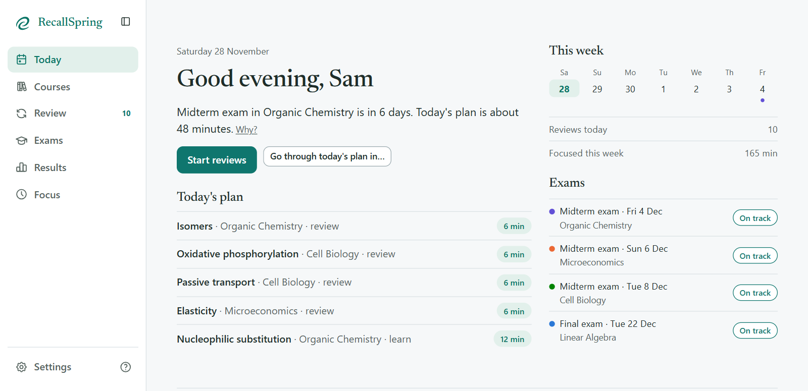
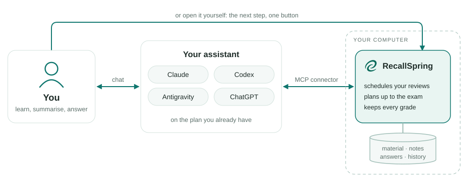
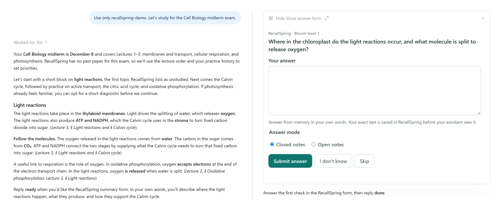
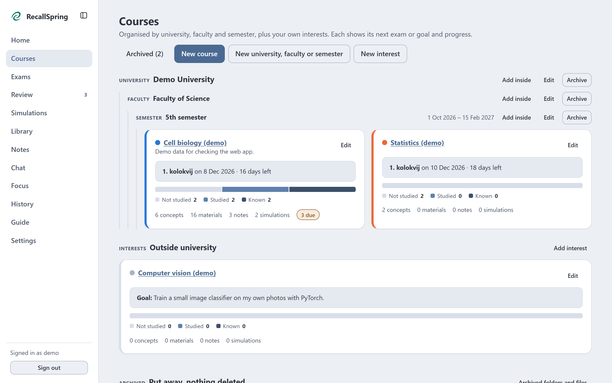
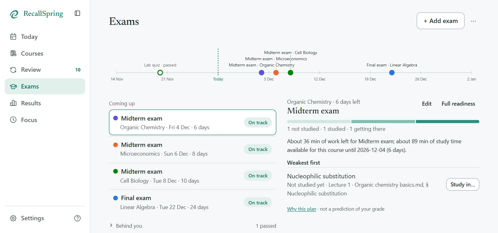
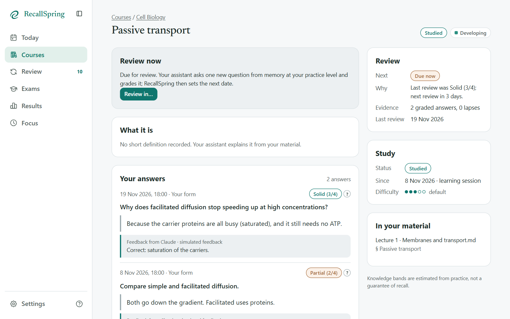
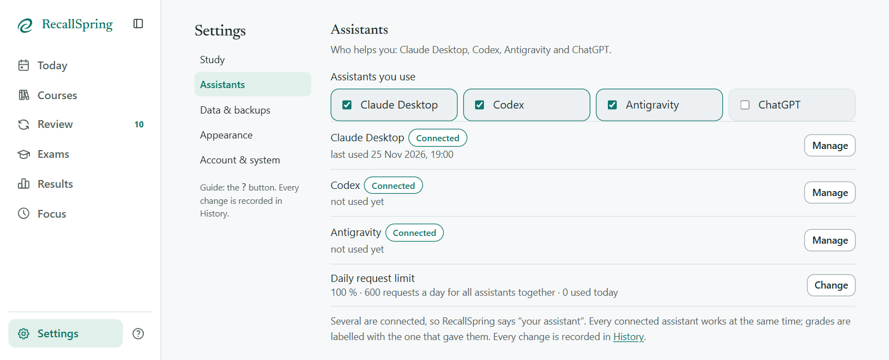

<p align="center">
  
</p>

<h3 align="center">RecallSpring</h3>

<p align="center">
    Open-source study app that plans your reviews and tracks what you have learned.
    <br />
    <br />
    <a href="#why-recallspring"><strong>Why RecallSpring</strong></a> ·
    <a href="#how-it-works"><strong>How it works</strong></a> ·
    <a href="#features"><strong>Features</strong></a> ·
    <a href="#assistants"><strong>Assistants</strong></a> ·
    <a href="#get-started"><strong>Get started</strong></a> ·
    <a href="#contributing"><strong>Contributing</strong></a>
</p>

<p align="center">
  <a href="LICENSE"></a>
  
  
</p>

<br/>

<p align="center">
  
</p>

## Why RecallSpring

- **Bring the AI you already have.** Study with Claude, Codex, Google Antigravity or ChatGPT, on the plan you already
  pay for. No API keys, no extra subscription, and never a silent switch to paid API usage.
- **Continue anywhere.** Start a topic in Claude tonight and pick it up in Codex tomorrow. Your answers, grades and
  plan live in RecallSpring, not in a chat, so every assistant knows where you left off. Switch any time; nothing
  is locked in.
- **Works without AI too.** The review schedule and your study plan are worked out by RecallSpring itself, with no
  model call. Without an assistant you still have your material, notes, reviews and self-assessment.
- **Learn first, no flashcards to manage.** You study your own material and summarise it in your own words; the
  questions come after. Spaced repetition runs by itself: reviews are scheduled from your graded answers and planned
  around your exam dates.
- **Your data stays yours.** It runs on your own computer. Export everything as plain files, keep a readable copy in
  your own Google Drive, Dropbox or OneDrive, and back up encrypted.

## How it works

<p align="center">
  <picture>
    <source media="(prefers-color-scheme: dark)" srcset="assets/diagrams/how-it-works-dark.svg" />
    
  </picture>
</p>

1. **Add your course and material.** Slides, PDFs, Office files, photos of your notes. Set the date of your midterm
   exam and, if you have one, add an old exam paper.
2. **Study with your assistant.** It reads today's plan from RecallSpring, teaches from your material with page
   citations, and asks you to summarise in your own words before any question.
3. **Answer, get graded, move on.** Every answer is saved before it is graded, and every grade keeps its reasons and
   sources. RecallSpring decides what to review and when, so you only open it and press the next step.

<p align="center">
  
</p>


## Features

**Learn**

- **Learn first, then practise.** Your assistant teaches part by part, with page citations, at the pace you choose.
  Practice on material you have not studied is refused.
- **Check first, if you like.** A short check per chapter puts what you already know in the background.
- **Built on Bloom's taxonomy.** Practice climbs from applying to analysing to evaluating as your answers become solid.
- **Concept-to-Clarity.** Explain a concept in your own words, version after version, and see what is missing.

**Remember**

- **Spaced repetition that schedules itself.** Grades from 0 to 4 set the next review; the last ones before an exam
  are planned around its date.
- **Midterm and final exams.** Your readiness per topic, the weakest first, and why the plan looks the way it does.
- **Exam simulations you can retake** in the style of your old exam paper, compared question by question.
- **Say how sure you are.** `Unsure` and `I'm guessing` keep a lucky guess from counting as known.

**Own your data**

- **Private by default.** Runs on `127.0.0.1`; nothing is sent to the RecallSpring authors.
- **Export** your material by course, notes as Markdown, and answers and grades as CSV and JSON.
- **Your cloud folder:** a readable copy of your material, by course, in your own Google Drive, Dropbox or
  OneDrive.
- **Backups** every night, checked by a test restore, optionally encrypted and copied to the cloud.
- **Nothing is lost by accident.** Deleting can be undone for 30 days, and History shows every change.

<table>
  <tr>
    <td width="50%"></td>
    <td width="50%"></td>
  </tr>
  <tr>
    <td align="center"><sub>Your courses and progress</sub></td>
    <td align="center"><sub>Exams on one timeline, weakest topics first</sub></td>
  </tr>
  <tr>
    <td width="50%"></td>
    <td width="50%"></td>
  </tr>
  <tr>
    <td align="center"><sub>Every grade with its reasons and sources</sub></td>
    <td align="center"><sub>Use one assistant or several</sub></td>
  </tr>
</table>

<sub>Screenshots from demo data in the default RecallSpring White theme (one of eight in Settings → Appearance).</sub>


## Assistants

| Assistant | How it connects | What you need |
| --- | --- | --- |
| **Claude Desktop** | MCP connector | your Claude plan |
| **Codex** | the same MCP connector | your ChatGPT plan |
| **Google Antigravity** | the same MCP connector | your Google plan |
| **ChatGPT in RecallSpring** | *Sign in with ChatGPT* in the app's Chat | your ChatGPT plan |

Use one, or several at once. Grades from any of them count the same. See
[docs/04-AI-INTEGRATION.md](docs/04-AI-INTEGRATION.md).

## Get started

RecallSpring runs on your own Windows 10 or 11 computer; a Linux home-server setup comes next.

1. Install Python 3.12+, Node.js 22+, Docker Desktop and Git.
2. Get the code and run the installer:

   ```powershell
   git clone https://github.com/kek-tilen/RecallSpring.git recallspring
   cd recallspring
   powershell -ExecutionPolicy Bypass -File scripts\install.ps1
   ```

3. Open `http://127.0.0.1:4318/`. The first visit creates your account and asks which assistant you study with.

The API and the worker run in the background without a window:

| Command | What it does |
| --- | --- |
| `scripts\start-local.ps1` | start RecallSpring (after a restart of the computer) |
| `scripts\start-local.ps1 -Status` | show whether the API and the worker run |
| `scripts\start-local.ps1 -Restart` | restart them, e.g. after an update |
| `scripts\logs.ps1` | follow the API log (`-Worker` for the worker) |

The full guide, with updates, backups and troubleshooting: [docs/install-windows.md](docs/install-windows.md).

> **Status:** early development. Expect changes, and keep your own backups.

## Contributing

Issues and pull requests are welcome.

- [Open an issue](../../issues) if you find a bug or something unclear.
- Read [AGENTS.md](AGENTS.md) first: its rules apply to people and coding agents alike. In short: no API keys, never
  run model-generated code, and save raw learner input before any model call.
- Make a pull request in small steps, with tests and the docs it changes.

### Tech stack

FastAPI (API) · SQLAlchemy and Alembic (data model, migrations) · PostgreSQL in Docker, loopback only (database) ·
React, TypeScript, Vite and TanStack Query (web app) · Model Context Protocol with MCP Apps (assistant connector and
in-chat forms) · PDFium (reading PDFs)

### Local development

```bash
# 1. Database (binds to 127.0.0.1 only); copy infra/.env.example to infra/.env with a random password first
docker compose -p recallspring-dev -f infra/compose.dev.yml --env-file infra/.env up -d

# 2. API (Windows paths; use .venv/bin/ on macOS and Linux)
cd services/api
python -m venv .venv
.venv/Scripts/python -m pip install --require-hashes -r requirements-dev.lock
.venv/Scripts/python -m pip install --no-deps --no-build-isolation -e .
cp .env.example .env    # set the password from infra/.env
.venv/Scripts/alembic upgrade head
.venv/Scripts/python -m pytest

# 3. Web app (served by the API at http://127.0.0.1:4318/)
cd apps/web
npm ci
npm run build
npm test
```

| Folder | What is in it |
| --- | --- |
| `services/api/` | FastAPI backend, migrations, scheduler, tests (configuration and demo seed: its README) |
| `services/mcp/` | the MCP connector for Claude Desktop, Codex and Antigravity |
| `apps/web/` | the web app |
| `packages/contracts/` | shared JSON schemas (assessments, visual blocks) |
| `docs/` | product, architecture, AI and security specification; decisions in `docs/10` |
| `scripts/` | installer, start and log scripts, assistant setup |

### Recommended versions

| Package | Version |
| --- | --- |
| Python | 3.12+ |
| Node.js | 22+ |
| PostgreSQL | 16 (from `infra/compose.dev.yml`) |

## License

Copyright (C) 2026 Kek Tilen. Questions: [kektilen@proton.me](mailto:kektilen@proton.me)

RecallSpring is free software under the [GNU Affero General Public License v3.0](LICENSE) (AGPL-3.0-only). You may
use, study, change and share it. If you change it and let others use it over a network, for example as a hosted study
service, you must offer them the source code of your version under the same license.
