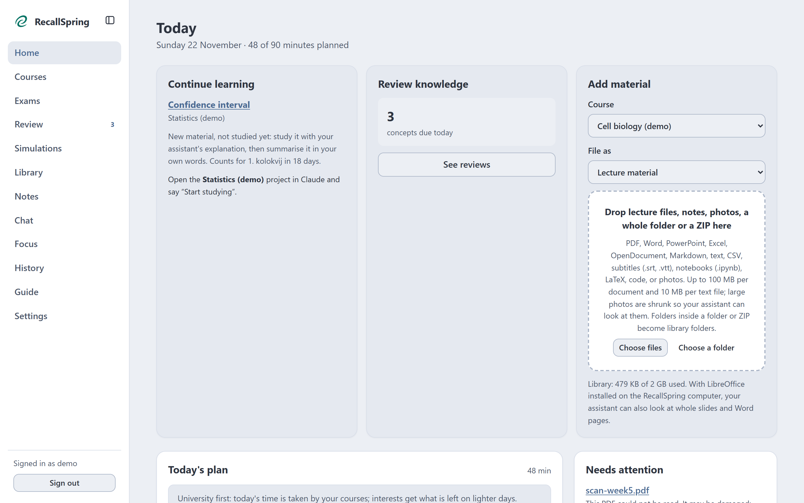
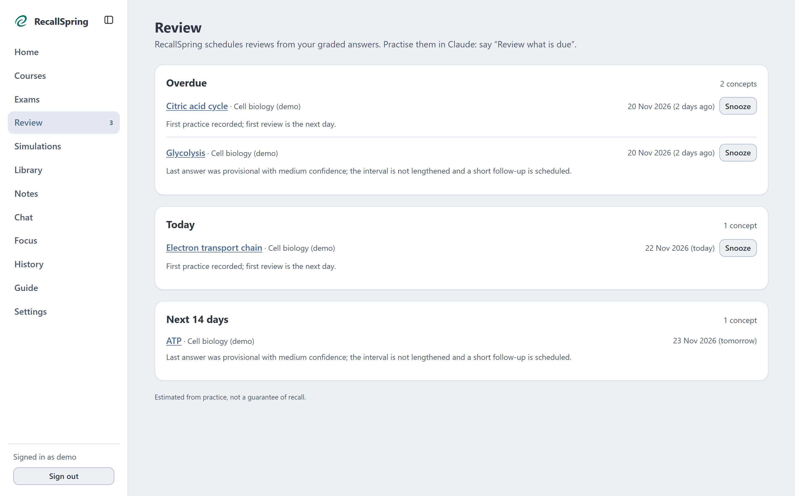

<p align="center">
  
</p>

<h3 align="center">RecallSpring</h3>

<p align="center">
    Open-source study app that plans your reviews and tracks what you have learned.
    <br />
    <br />
    <a href="#introduction"><strong>Introduction</strong></a> ·
    <a href="#features"><strong>Features</strong></a> ·
    <a href="#assistants"><strong>Assistants</strong></a> ·
    <a href="#tech-stack"><strong>Tech Stack</strong></a> ·
    <a href="#self-hosting"><strong>Self-hosting</strong></a> ·
    <a href="#contributing"><strong>Contributing</strong></a>
</p>

<p align="center">
  <a href="LICENSE"></a>
  
  
</p>

<br/>

<p align="center">
  
</p>

## Introduction

RecallSpring is a self-hosted study app built on **Hybrid Learning**. You lead the new learning: your material,
your notes, the questions you want to work through. RecallSpring handles the rest: it schedules spaced reviews, keeps
the evidence of what you really know, and plans your next session up to the kolokvij or exam. You never manage
flashcards, folders or intervals by hand.

The tutoring happens in the assistant you already use (Claude, Codex, Google Antigravity or ChatGPT). RecallSpring is
the memory behind it: every answer, grade and source citation is saved on your own computer, and the schedule is
worked out without any AI.

> **Status:** early development. It is used daily by its author, but expect changes and do not run it for others yet.

## Features

- **Learn first, then practise.** The assistant teaches from your material part by part, every concept completely
  and with page citations, at the pace you choose: step by step, balanced, larger chunks or auto (a default in
  Settings, its own per course). You summarise in your own words, and only then come the questions. The assistant
  never assumes you studied something, and practice on material you have not studied is refused.
- **Check first, if you like.** Already know part of it? A short check per chapter, or a bit of everything for the
  midterm, puts what you know in the background and brings the rest forward. A guess never counts as known.
- **Built on Bloom's taxonomy.** Reading and your own notes come first (remember, understand). Practice then climbs
  from 3 Apply to 4 Analyze to 5 Evaluate as your answers become solid, steps back after a weak answer, and mixes the
  levels once you reach the top. 6 Create joins when you choose it or your old exam paper asks for it. RecallSpring
  works out the next level from your grades, without a model call, and never goes above your practice limit.
- **Spaced review that schedules itself.** Grades from 0 to 4 on one shared scale set the next review, and the last
  reviews before an exam are planned around its date. `Review in…` starts a review with your assistant: a new
  question from memory for each due concept. Provisional grades only bring a short follow-up, never a longer
  interval.
- **Say how sure you are.** Mark an open answer as `Unsure`: it is graded like any other, and below Solid the
  assistant offers to explain that part again. On a multiple-choice question, `I'm guessing` keeps a lucky guess from
  counting as known.
- **Midterms and exams.** Set a target and its date, and add an old midterm or exam paper if you have one. Practice
  and simulations then follow its style: its question types, topic weights and Bloom mix. RecallSpring tracks your
  readiness per concept and explains why the plan looks the way it does.
- **Simulations you can retake.** Take a simulation again, all of it or only the questions without full points, and
  compare the versions question by question. The first version stays the benchmark, and a retake on the same day is
  practice only. Or ask for similar, new questions.
- **Concept-to-Clarity.** Explain a concept in your own words, version after version; the assistant says what is
  correct, missing or wrong. It trains understanding and is never a grade.
- **Study in your assistant.** `Study in…` on a course and `Go through today's plan in…` on Home open Claude, Codex
  or the app's Chat with the start message ready (for Antigravity it is copied). Nothing is sent for you.
- **Your material, searchable.** PDF, Office and ODF files, slides and photos go into the Library; extracted text is
  split into sections that the assistant cites by ID. Notes keep every revision.
- **Answers on paper.** Attach photos of handwritten work to an answer; the grading assistant sees them.
- **Self-assessment.** No assistant at hand? Check your answer against the expected points yourself. The grade is
  marked as yours and an assistant reviews it later.
- **Focus timer and history.** Pomodoro sessions per course, and a full, audited history of everything that changed.
- **Private by default.** Runs on `127.0.0.1`, with daily backups checked by a test restore. Deletions are
  soft-deletes you can undo, and the app is fully in English while your material can be in any language.

<table>
  <tr>
    <td width="33%"></td>
    <td width="33%"></td>
    <td width="33%"></td>
  </tr>
  <tr>
    <td align="center"><sub>Courses and progress</sub></td>
    <td align="center"><sub>Exams on one timeline</sub></td>
    <td align="center"><sub>Reviews that schedule themselves</sub></td>
  </tr>
</table>

<sub>Screenshots from demo data, in the Snow Storm theme (one of seven in Settings → Appearance).</sub>

## Assistants

| Assistant | How it connects | What you need |
| --- | --- | --- |
| **Claude Desktop** | MCP connector (`services/mcp`) | your Claude plan |
| **Codex** | the same MCP connector | your ChatGPT plan |
| **Google Antigravity** | the same MCP connector | your Google plan |
| **ChatGPT in RecallSpring** | *Sign in with ChatGPT* in the app's Chat | your ChatGPT plan |

You can use several at once (the **Mix** option). RecallSpring never asks for an API key and never falls back to
paid API usage. Without any assistant, everything except tutoring and AI grading keeps working: material, notes,
reviews, planning and self-assessment. See [docs/04-AI-INTEGRATION.md](docs/04-AI-INTEGRATION.md).

## Tech Stack

- [FastAPI](https://fastapi.tiangolo.com/) – API
- [SQLAlchemy](https://www.sqlalchemy.org/) and [Alembic](https://alembic.sqlalchemy.org/) – data model and migrations
- [PostgreSQL](https://www.postgresql.org/) – database (in Docker, loopback only)
- [React](https://react.dev/) and [TypeScript](https://www.typescriptlang.org/) – web app
- [Vite](https://vite.dev/) – build
- [TanStack Query](https://tanstack.com/query) – data fetching
- [Model Context Protocol](https://modelcontextprotocol.io/) – the assistant connector, with in-chat forms (MCP Apps)
- [PDFium](https://pdfium.googlesource.com/pdfium/) – reading PDFs

## Self-hosting

RecallSpring runs on your own computer; Windows is supported now, and a Linux home-server setup comes next.

1. Install Python 3.12+, Node 22+ and Docker Desktop.
2. Run the installer:

   ```powershell
   powershell -ExecutionPolicy Bypass -File scripts\install.ps1
   ```

3. Open `http://127.0.0.1:4318/`. The first visit creates your account and asks which assistant you study with.

The API and the worker run in the background without a window:

| Command | What it does |
| --- | --- |
| `scripts\start-local.ps1` | start RecallSpring (after a restart of the computer) |
| `scripts\start-local.ps1 -Status` | show whether the API and the worker run |
| `scripts\start-local.ps1 -Restart` | restart them, e.g. after an update |
| `scripts\logs.ps1` | follow the API log (`-Worker` for the worker) |

The full guide, including updates and troubleshooting, is in [docs/install-windows.md](docs/install-windows.md).
Backups go to `local-data/backups` once a day; point `RS_BACKUP_DIR` at another disk for real protection.

## Contributing

Issues and pull requests are welcome.

- [Open an issue](../../issues) if you find a bug or something unclear.
- Read [AGENTS.md](AGENTS.md) first: its rules apply to people and coding agents alike. In short: no API keys, never
  run model-generated code, and save raw learner input before any model call.
- Make a pull request in small steps, with tests and the docs it changes.

### Local development

```bash
# 1. Database (binds to 127.0.0.1 only); copy infra/.env.example to infra/.env with a random password first
docker compose -p recallspring-dev -f infra/compose.dev.yml --env-file infra/.env up -d

# 2. API (Windows paths; use .venv/bin/ on macOS and Linux)
cd services/api
python -m venv .venv
.venv/Scripts/python -m pip install --require-hashes -r requirements-dev.lock
.venv/Scripts/python -m pip install --no-deps --no-build-isolation -e .
cp .env.example .env    # set the password from infra/.env
.venv/Scripts/alembic upgrade head
.venv/Scripts/python -m pytest

# 3. Web app (served by the API at http://127.0.0.1:4318/)
cd apps/web
npm ci
npm run build
npm test
```

| Folder | What is in it |
| --- | --- |
| `services/api/` | FastAPI backend, migrations, scheduler, tests (configuration and demo seed: its README) |
| `services/mcp/` | the MCP connector for Claude Desktop, Codex and Antigravity |
| `apps/web/` | the web app |
| `packages/contracts/` | shared JSON schemas (assessments, visual blocks) |
| `docs/` | product, architecture, AI and security specification; decisions in `docs/10` |
| `scripts/` | installer, start and log scripts, assistant setup |

### Recommended versions

| Package | Version |
| --- | --- |
| Python | 3.12+ |
| Node.js | 22+ |
| PostgreSQL | 16 (from `infra/compose.dev.yml`) |

## License

Copyright (C) 2026 Kek Tilen. Questions: [kektilen@proton.me](mailto:kektilen@proton.me)

RecallSpring is free software under the [GNU Affero General Public License v3.0](LICENSE) (AGPL-3.0-only). You may
use, study, change and share it. If you change it and let others use it over a network, for example as a hosted study
service, you must offer them the source code of your version under the same license.
