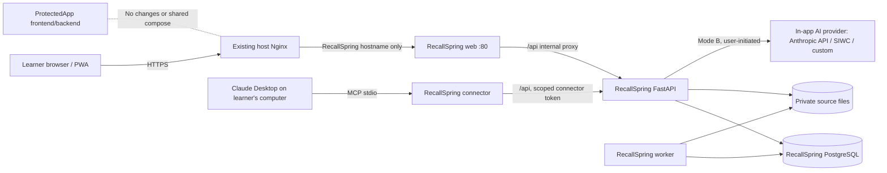

# 02 — Technical Architecture

## Principles

Lightweight, modular, secure-by-default, self-hosted, single-user-first, no vendor lock-in of stored learning records, pluggable AI with no mandatory paid usage, local-first, independently deployable without touching ProtectedApp.

## Recommended stack

| Layer | Choice | Reason |
|---|---|---|
| Frontend | React 19 + TypeScript + Vite | Responsive UI, validated interactive visual components |
| Styling | CSS variables / Tailwind if useful, accessible UI primitives | Consistent Sage Study; easy theme override |
| State/data | TanStack Query + lightweight local store | Autosave, optimistic updates, streaming status |
| Offline | Service worker / PWA + IndexedDB outbox | Offline notes, resilient retry; not offline model inference |
| Backend | Python 3.12+ FastAPI + Pydantic | Structured API, async streaming, extraction ecosystem |
| Storage | PostgreSQL 16+ with migrations (Alembic) | Durable relational data, source provenance and review queue |
| Worker | Separate low-resource process using same backend image, PostgreSQL SKIP LOCKED job table | Avoid Redis; upload processing and deterministic tasks |
| Document extraction | pypdf (PDF), PDFium (`pypdfium2`) when pypdf cannot open a PDF (e.g. AES-protected slides); Word/PowerPoint/Excel and OpenDocument with the Python standard library (zipfile + expat, `ingest/office.py`, `ingest/odf.py`); CSV, subtitles, notebooks, LaTeX and code (`ingest/formats.py`); text/Markdown parsers; page images for Claude with PDFium (`pypdfium2`), picture conversion with Pillow (`ingest/visuals.py`); optional whole-page rendering with LibreOffice (`ingest/renderer.py`) | Local text extraction; OCR deliberately out-of-scope initially |
| Visualization | React + SVG + vetted chart/diagram components | Render allowlisted JSON, not executable LLM code |
| AI | MCP connector for the Claude app (Mode A) + `LLMProvider` adapters: Anthropic API (official SDK), SIWC, later OpenAI-compatible (Mode B) | Owner's Claude plan without API billing; providers swappable and feature-gated |
| Infra | Docker Compose (`recallspring`) + existing host Nginx | Separate services and controlled resources |

Do not hardcode exact package versions until dependency/security review; pin versions and lockfiles in the repository before release.

## Components



Backend is the sole writer of core state. Browser keeps draft outbox and version numbers. AI client is a module in the backend, never exposed directly to browser. Stored materials, retrieval indexes, reviews and assessments are RecallSpring-owned.

## Suggested repository

```text
recallspring/
  AGENTS.md
  apps/web/            # React PWA
  services/api/        # FastAPI, auth, upload, tutoring, sync
  services/worker/     # background ingestion + due-plan tasks
  services/mcp/        # Claude connector (MCP server, thin API client)
  packages/contracts/  # OpenAPI-generated TS client, JSON schemas
  db/migrations/
  infra/compose.yml
  infra/nginx/          # separate RecallSpring vhost example, NOT existing site
  tests/unit/
  tests/integration/
  tests/e2e/
  docs/
```

## Resource strategy (initial hypotheses, validate with runtime metrics)

Target incremental idle consumption **under 1 GiB**, with bounded spikes. Suggested memory caps: frontend <=128 MiB, API <=512 MiB, worker <=256 MiB, PostgreSQL <=384 MiB; not additive guarantees. Use single API worker unless load proves need, cap upload size, cap inference concurrency to 1–2, and stream long outputs. Prefer multi-stage slim images and **build off VPS** to avoid massive Docker cache growth. Ingestion concurrency = 1. Disk gate: refuse production setup if free disk <10 GiB after owner-approved housekeeping and reserving space for logs/backups.

No on-VPS local model; the VPS's limited RAM is insufficient for acceptable comparable tutoring on the same host.

## Local-first operation

Until a VPS deployment is approved, RecallSpring runs on the owner's computer: API on `127.0.0.1:4318`, web UI on `127.0.0.1:4317`, development PostgreSQL on `127.0.0.1:55432` (dev only; never published in production). Claude Desktop starts the connector as a local stdio process. Nothing listens on non-loopback interfaces.

## Networking and safe rollout

- Compose project name `recallspring`, internal network `recallspring_internal` and volumes prefixed `recallspring_`; avoid manual container-name collisions.
- Frontend publishes **`127.0.0.1:4317:80`** only if host Nginx needs loopback access; API/Postgres/worker publish **no host ports**.
- Frontend Nginx proxies `/api/*` to backend over private bridge; websocket/SSE streaming handled with appropriate buffering/timeouts.
- Separate proposed host file `/etc/nginx/sites-available/recallspring` with server_name **placeholder**. Never edit the existing ProtectedApp vhost or global Nginx without approval.
- Existing Nginx presently listens on 80; HTTPS on 443 must be established after DNS and certificate approval. No public data/credential access before HTTPS.
- Never start `docker compose` in the protected application's directory (see private operator snapshot) or omit `-p recallspring -f <explicit filepath>` in operational scripts.

## Data transactions and crash recovery

1. User posts attempt (client request UUID). API commits `attempt` and immutable `learning_event` in one transaction.
2. API acknowledges durable save; then launches or queues AI evaluation work.
3. Evaluation writes `assessment`, updates mastery and review schedule in a new transaction using idempotency key and version check.
4. If stream/AI fails, attempt remains `awaiting_evaluation`; user can retry safely.
5. When teacher corrects grade, append correction event; recompute schedule from raw immutable attempts; do not overwrite prior evaluator result.

## Synchronization

- Server authoritative; every mutable record has `revision`, `updated_at`, `deleted_at`.
- Browser outbox stores idempotency key, object ID, base revision, patch, timestamp; flushes on reconnect.
- Concurrent edits cause `409 Conflict`, preserve both versions and allow user choice/merge. Answer submissions append-only and safe to replay once.
- No multi-device instant collaborative editing required; eventual sync on connection is acceptable.

## Boundaries and future growth

Implement provider adapters and document parsers behind interfaces so provider changes (connector, SIWC, Anthropic API, custom LLMs) or additional source types do not force database redesign. Full-text search via Postgres initially; semantic embeddings/vector DB only if a demonstrated need arises and can work within user-selected AI authorization scope.
